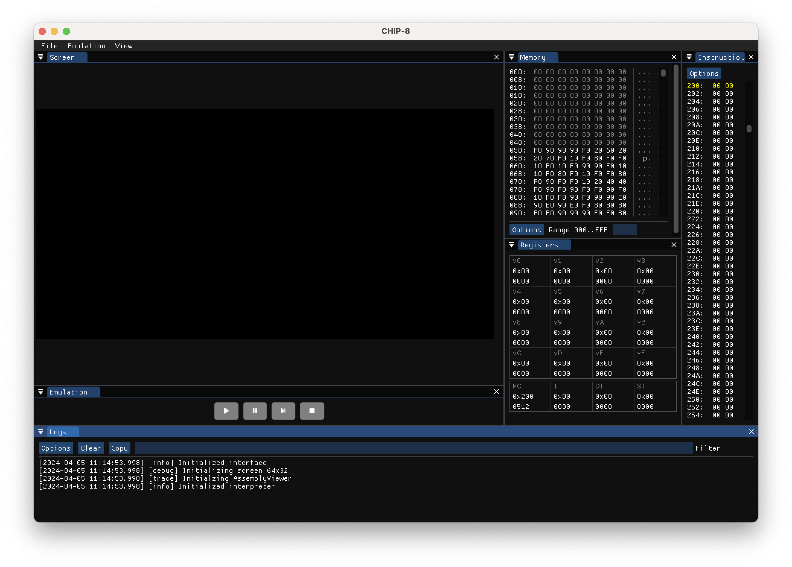
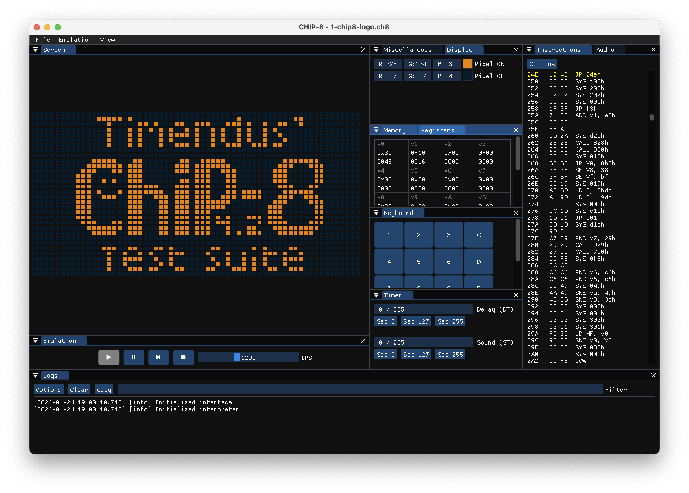
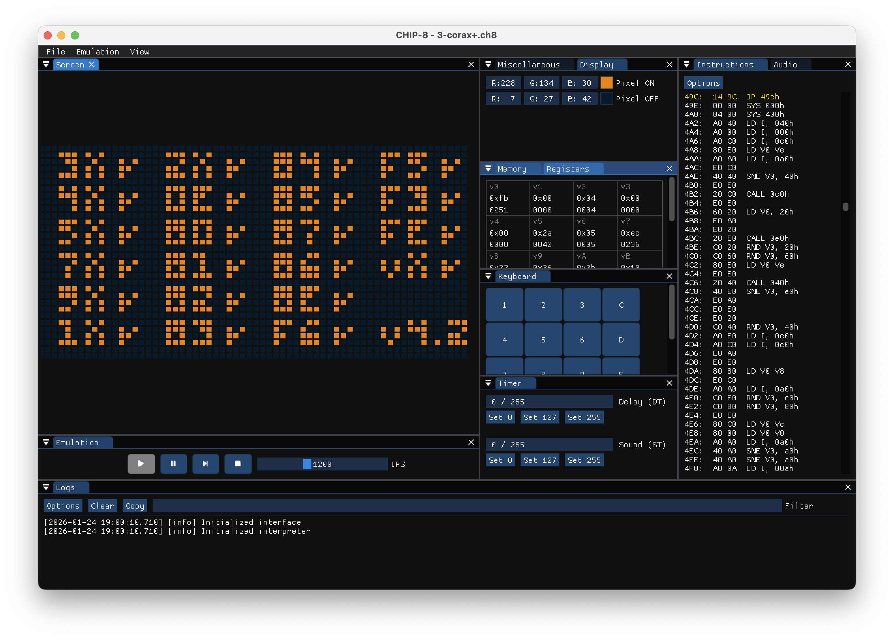
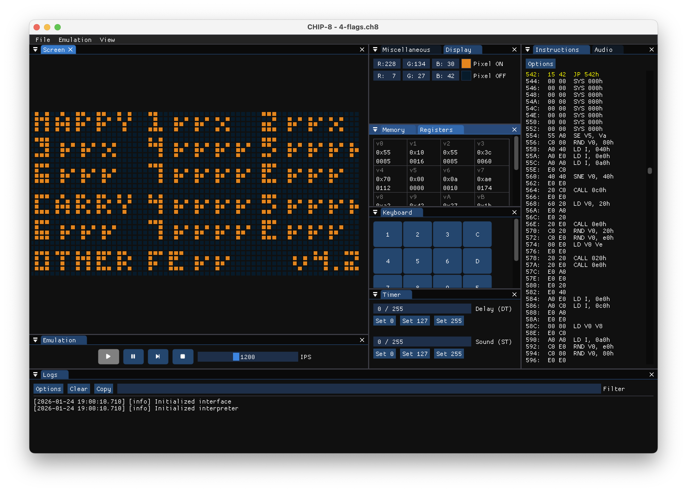
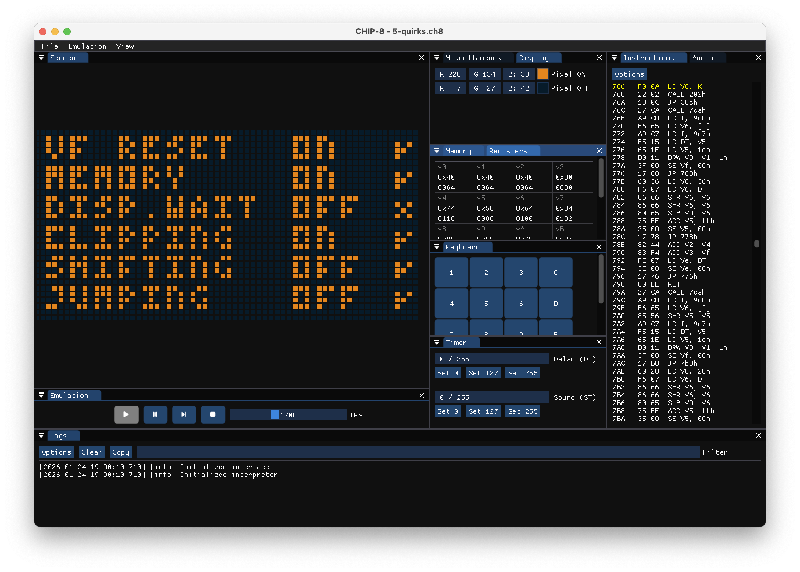
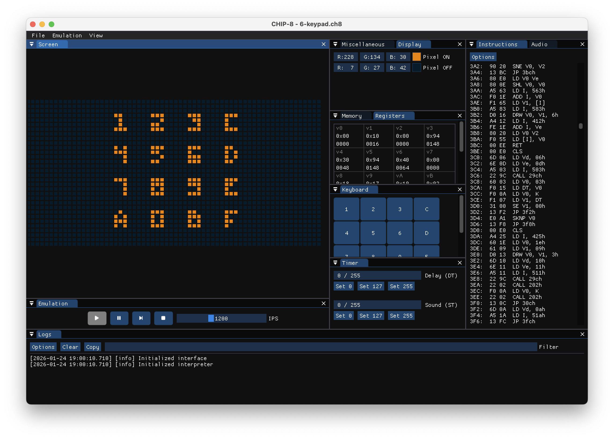
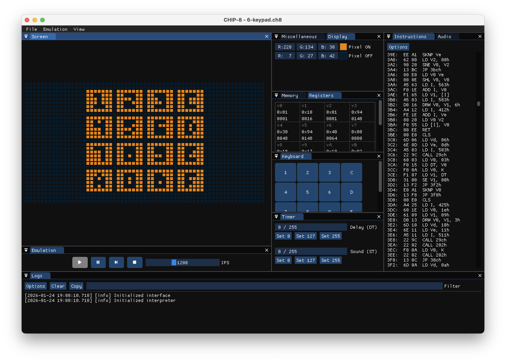
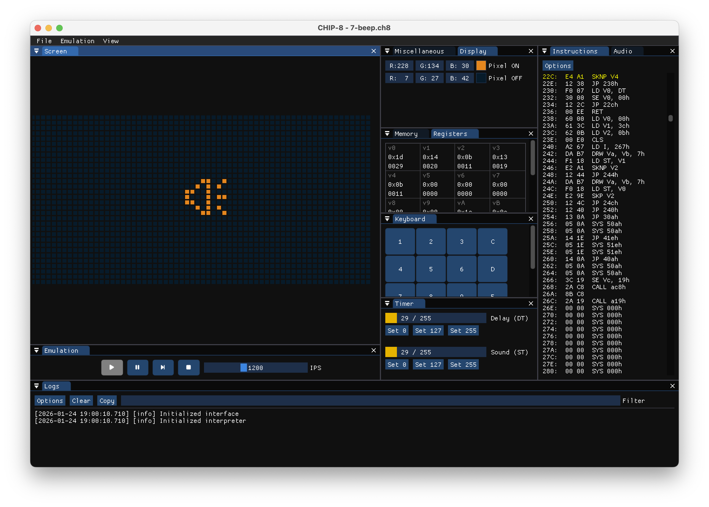
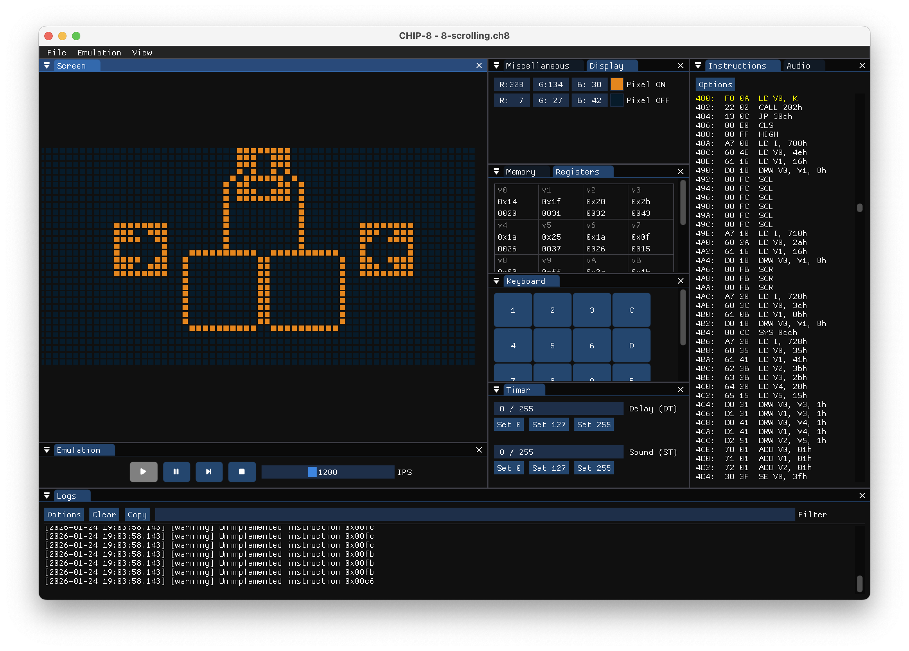

# CHIP-8 Emulator

## How to build

 - Clone repo `git clone git@.../ace-chip8.git`
 - Cd to repo directory: `cd ace-chip8`
 - Run command: `make`
 - Run executable: `make run`

## Test Suite Results

